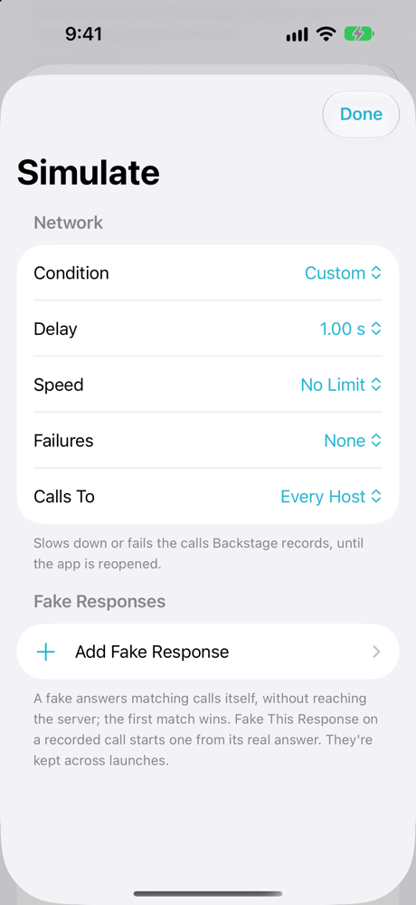
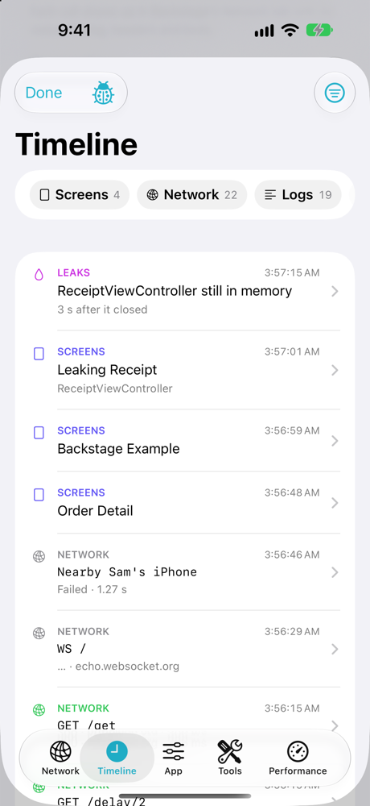
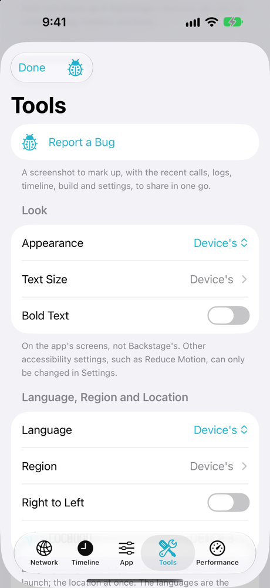
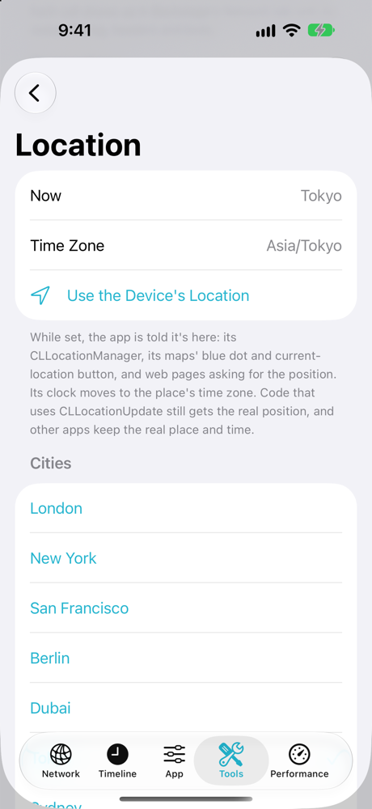
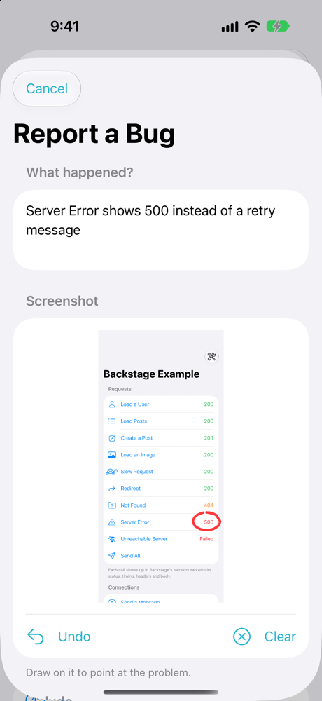

# Backstage

An in-app debug panel for the owner's iPhone, iPad and Mac apps: every network call the app makes,
a timeline of what it did, a slow or failing network and fake responses, a server switch and the
app's own actions and switches, tools for testing (a fake location, language, look, deep links,
notifications, storage, a fresh start), performance overlays, and the reports iOS collects. It's
off and invisible in App Store builds.

<p align="center">
  
</p>

| Network | Request | Simulate |
|---|---|---|
|  |  |  |
| **Timeline** | **App** | **Tools** |
|  |  |  |
| **Location** | **Report a Bug** | **Overlays** |
|  |  |  |

It's for the owner only:

| Where the app runs | Backstage |
|---|---|
| Xcode (a Debug build, the simulator, or any build run from Xcode) | On from launch. Shake, ⌃⌥⌘D, or the hidden trigger opens it. |
| TestFlight | Off and invisible. The hidden trigger asks for a passphrase; a device unlocked with it stays unlocked until **Lock**. Recording starts when you unlock (the Network tab says so), and from the next launch on it starts at launch. Testers' devices record nothing. |
| App Store | Off. Nothing is recorded and nothing opens it. A device unlocked in TestFlight that installs the App Store version is locked again, so its Backstage settings (such as a staging server) stop applying. |

TestFlight and App Store builds are the same binary, so Backstage decides when the app runs: it
asks StoreKit's `AppTransaction` (`.xcode`, `.sandbox` for TestFlight, `.production`). Anything it
can't tell counts as the App Store. On iPhone and iPad, an App Store install's receipt also keeps
Backstage off from the first moment of launch, before StoreKit answers.

## Trying it

`Example/BackstageExample.xcodeproj` is a small app that uses everything: requests to public test
servers (JSON, an image, a redirect, a 404, a 500, a slow one, one that fails), a WebSocket to an
echo server, a made-up Nearby connection, a server switch, switches, actions, a few UserDefaults
values and a Keychain item, a button that freezes the main thread, a named SwiftUI screen, a UIKit
screen that leaks on purpose, a link scheme (`backstage-example://`), its own notification
handling, and Where Am I? and a map (with the local time) to try the fake location. It uses this
checkout of the package, so changes show up at once.

Open it in Xcode and run it on a simulator or a Mac. It's a Debug build, so Backstage is on: tap the
wrench, tap Version seven times, shake, or press ⌃⌥⌘D. Its TestFlight passphrase is
`backstage-example`.

## Adding it to an app

Backstage needs iOS 18 or macOS 15 and has no dependencies.

1. Add the package by its URL (Xcode > Add Package Dependencies) and the **Backstage** product to
   the app target. For Xcode Cloud, give it access to this repository once (App Store Connect >
   Xcode Cloud > Settings > Repositories).
2. Make a passphrase hash: `swift run backstage-passphrase` in this repository. It asks for the
   passphrase (8 characters or more; mix letters, digits and symbols) without showing it and
   prints the salt and hash. Only those go in the app. The hash is PBKDF2-HMAC-SHA256 with 600,000
   rounds, so someone who finds it in the app can only test a few guesses a second; a long
   passphrase keeps it out of reach.
3. Start it first thing at launch, before anything makes a network session:

   ```swift
   import Backstage

   @main
   struct MyApp: App {
       private let backstage: Void = Backstage.shared.start(
           BackstageConfiguration(passphraseSalt: "…", passphraseHash: "…")
       )

       var body: some Scene {
           WindowGroup {
               RootView()
                   .backstage()
           }
       }
   }
   ```

4. Put the hidden trigger on something unremarkable, such as the version row in Settings:

   ```swift
   LabeledContent("Version", value: version)
       .backstageTrigger()   // seven taps, each within two seconds of the last
   ```

5. Record the app's sessions: `Backstage.record(configuration)` on each `URLSessionConfiguration`
   before making the session. `URLSession.shared` is recorded without it. Set `recordsAllSessions`
   in the configuration to also record libraries' sessions (it adds the recording protocol to
   every new `.default` and `.ephemeral` configuration, only while Backstage is on).

6. Fill the App tab. Backstage shows the build and the device by itself; the rest comes from the
   app, through `Backstage.shared.registry`, right after `start(_:)`:

   ```swift
   let registry = Backstage.shared.registry

   // A server switch: the first server is the app's own.
   registry.addServers(key: "api", servers: [
       .init("Live", url: URL(string: "https://api.example.com")!),
       .init("Staging", url: URL(string: "https://staging.example.com")!)
   ])

   // Lines of information, read each time the tab is shown. `group` names the section.
   registry.addInfo("User ID", group: "Account") { session.userID }

   // Switches and buttons.
   registry.addSwitch("Use mock data", key: "mockData", footnote: "Answers without the server.")
   registry.addAction("Sign out", group: "Account", isDestructive: true) { await session.signOut() }
   ```

   The app reads the choices itself. Read the server once at launch, before making its client;
   the switch can be read any time:

   ```swift
   let baseURL = Backstage.server(for: "api") ?? URL(string: "https://api.example.com")!
   if Backstage.isOn("mockData") { … }
   ```

   Both answer "nothing chosen" in App Store builds and while Backstage is off, so the app falls
   back to its own server and behaviour. A server chosen in the panel is used from the next launch:
   the tab says so until the app is reopened, and a strip at the top of the screen then shows the
   server while it isn't the app's own. "Other address" takes any address, such as a server on the
   Mac (`192.168.1.10:8080`; http is assumed). See
   [the example app](Example/BackstageExample/BackstageExampleApp.swift) for each kind.

7. Optionally, tell Backstage more. Each call does nothing while Backstage is off:

   ```swift
   // Name a SwiftUI screen in the Timeline (UIKit screens are noticed on their own).
   OrderDetail().backstageScreen("Order Detail")

   // Check that an object is freed soon, such as a view model when its screen closes.
   Backstage.expectRelease(of: viewModel)

   // Hand over a push Backstage can't see by itself, such as a silent one.
   Backstage.recordRemoteNotification(userInfo)

   // Record a WebSocket or another connection, with its messages. `nil` while Backstage is off.
   let recording = NetworkRecorder.shared.openConnection(kind: .webSocket, url: url)
   recording?.opened(statusCode: 101)
   recording?.sent(text: message)
   recording?.received(text: reply)
   recording?.closed()
   ```

   The configuration also takes `sensitiveHeaders`, the headers kept hidden (compared without
   case; to start with `Authorization`, `Proxy-Authorization`, `Cookie`, `Set-Cookie` and
   `X-API-Key`), and `limits`, how many calls and how much of their bodies are kept.

## What's in the panel

However it's opened, the panel comes back on the tab it was last on. The ladybug on every tab
reports a bug.

- **Network.** Every HTTP call: method, URL, status, timing, headers and bodies (cut at 1 MB), with
  search and filters (kind, status, method, host, this launch only), pretty JSON, copy as cURL,
  and export as HAR or JSON. `Authorization`, cookies and API keys stay hidden until tapped and are
  left out of exports. The last 1,000 calls are kept across launches in the app's Caches.
  WebSockets and other connections the app reports show with their messages; the recording
  protocol itself leaves WebSocket tasks alone. A redirect shows as its own call, followed by the
  one it led to. Recorded calls go out with the shared cookies, cache and credentials, as
  `URLSession.shared` does, and a server's challenge (its certificate, or a password) still goes to
  the app's own session delegate, so certificate pinning and sign-in work as without Backstage.
- **Simulate** (the dial in the Network tab). For the calls Backstage records:
  - A network condition: Slow 3G (2 s, 50 KB/s), Flaky (a fifth of calls drop), Offline, or a
    custom delay, speed and failure rate, for every host or one. It lasts until the app is
    reopened.
  - Fake responses: rules that match a method and a URL (`*` stands for anything; without a `?` the
    query is ignored) and answer with a status, headers and body, or with a failure such as a
    timeout, without reaching the server. **Fake This Response** on a recorded call starts one from
    its real answer, when its body was kept in full. They're kept across launches, each with its
    own switch.

  Simulated calls are tagged in the list, and an orange strip at the top of the screen shows what's
  on (`Offline · 2 fakes`). WebSockets and other reported connections aren't affected.
- **Timeline.** What happened, newest first: screens shown, network calls, log messages,
  notifications, main-thread hangs, screens that stayed in memory after closing, and crashes from
  iOS's reports. Chips filter by kind (Logs alone gives the plain log), and the menu shows earlier
  launches. Logs are this launch's `Logger` and `NSLog` messages, read with `OSLogStore`; only the
  app's own code is shown (its executable, the packages linked into it and its frameworks) unless
  **App's Messages Only** is turned off.
- **App.** Where it runs, the build and the device, then what the app adds (step 6 above):
  - `addServers(key:servers:)`: a server switch, read with `Backstage.server(for:)`.
  - `addInfo(_:group:value:)`: lines of information, such as IDs.
  - `addSwitch(_:key:group:footnote:)`: switches, read with `Backstage.isOn(_:)`.
  - `addAction(_:group:isDestructive:perform:)`: buttons.
  - **Lock Backstage**, in TestFlight builds.
- **Tools.**
  - **Report a Bug**: a screenshot of the app to draw on, with what happened, this launch's calls
    (HAR, secrets left out), logs and timeline, and the build, device, server, switches and testing
    changes, shared as one zip.
  - **Look:** dark or light appearance, text size up to the largest accessibility sizes, and bold
    text, on the app's screens but not Backstage's.
  - **Language and Region:** the app's language (from those it's translated into), region, and
    right-to-left layout, from the next launch; **Quit App to Apply** closes it.
  - **Location:** a place the app is told it's at: a city, or any place by its coordinates (pasted
    from Apple Maps' Copy Coordinates or Google Maps), with a name and a time zone. The app's
    `CLLocationManager` reports it, through its `location` and the locations its delegate gets, and
    so do MapKit's blue dot and current-location button and web pages asking for the position. The
    app's time zone becomes the place's, so `TimeZone.current`, date formatting and calendars show
    its local time. It applies at once and across launches until cleared, with the orange strip
    showing it. Code that uses `CLLocationUpdate` still gets the real position, and other apps and
    the system keep the real place and time. Backstage uses neither MapKit nor CoreLocation's API
    directly; it reaches the location classes at run time, so an app that never uses location
    isn't asked by App Store Connect why it does.
  - **Testing:** animations at half, a quarter or a tenth of their speed, and **Show Touches**, a
    circle under each finger for screen recordings.
  - **Deep Links:** open any link as if tapped elsewhere, with a history; the app's schemes are
    listed.
  - **Notifications:** each notification the app gets while Backstage is on, with its payload:
    arrived while open, tapped, or left in Notification Center. They're noticed through the app's
    own notification handling, which runs as before. **Send a Test Notification** schedules one
    with any title, body and payload.
  - **Permissions:** what the app was allowed, read without asking: notifications, and those its
    Info.plist has a usage description for (location, camera, microphone, photos, contacts,
    calendars, reminders, Bluetooth, motion, tracking). Backstage doesn't link those frameworks, so
    an app that never asks for, say, contacts isn't asked by App Store Connect to explain why.
  - **Storage:** the app's UserDefaults (edit, delete), Keychain items, iCloud-synced ones too
    (show a value after confirming, delete) and files (browse, share, delete after confirming). On
    a Mac app outside the sandbox, only its own Keychain items and folders, never the user's.
  - **Reset App:** deletes the app's UserDefaults, Keychain items, files, cookies and cache and
    closes it, to test first launch without reinstalling, keeping Backstage's settings and records
    or not. The device stays unlocked.

  The look, location and testing changes only apply while Backstage is on, stay across launches,
  and go with **Undo Testing Changes**. A value the app set itself, such as its own language
  setting or a text size it holds its windows to, is put back afterwards and otherwise left alone.
- **Overlays** (at the top of the Performance tab), small windows above every screen. Each can be
  dragged anywhere and stays where it's left; tapping one opens Backstage, and a long press offers
  **Report a Bug** and **Hide Overlay**. They stay on across launches.
  - **Performance:** frame rate, dropped frames, memory and CPU, and a one-minute graph. A flash
    marks a main-thread hang (over 250 ms).
  - **Network:** this launch's calls. **Compact** shows the calls running and failed in the last
    minute, the last call, and a bar per call coloured by result, taller the slower. **Ticker**
    lists the last five calls. **In Performance Overlay** adds two lines to it instead of a window
    of its own.
  - **Alerts on failed or slow calls:** a short alert at the bottom of the screen for a call that
    fails or takes 2 s or more, gone after a few seconds. On with any of the above, or alone.
- **Performance.** The tab adds charts of the last minute, the last hangs, the screen's top rate
  and **Possible Leaks**: the app's view controllers still in memory 3 s after they closed (often a
  retain cycle), and objects the app asks about with `Backstage.expectRelease(of:)`. On a 120 Hz
  iPhone, iOS holds an app to 60 fps unless its Info.plist sets
  `CADisableMinimumFrameDurationOnPhone` to YES; the tab says so when it's missing (the example app
  sets it).
- **Reports from iOS** (in the Performance tab). What iOS collects about the app through MetricKit:
  crashes, hangs, CPU and disk-write overuse and slow launches with their call stacks, which arrive
  on the next launch, and a daily summary (typical launch and hang, peak memory, CPU, disk writes,
  scroll hitches, time on screen and in the background). Each can be copied or shared as iOS wrote
  it. Call stacks are addresses; Xcode or `atos` turns them into names with the build's dSYM.
  Reports delivered while Backstage was off are picked up when it turns on, and kept for 30 days in
  the app's Caches. A crash reporter the app already uses keeps getting its own. Nothing arrives in
  the simulator: on a device connected to Xcode, Debug > Simulate MetricKit Payloads sends samples,
  and the example app has **Add sample iOS reports**.

## How it's built

- `BackstageCore`: when it's on, the passphrase, the recorder (`NetworkRecorder`,
  `RecordingURLProtocol`), the simulator (`NetworkSimulator`), logs, Keychain, performance
  sampling, iOS's reports (`IOSReportStore`), screens, notifications and leaks (`AppActivity`),
  resetting the app (`AppReset`), and the fake location (`LocationSimulator`). No UI. Nothing is
  swizzled until Backstage is on: then `URLSessionConfiguration` (with `recordsAllSessions`), the
  notification center's delegate, `UIViewController` appearances, `UIWindow` events while Show
  Touches is on, and, while a location is set, `CLLocationManager` and every loaded class that
  takes its updates (such as MapKit's), with the `TZ` variable set to the place's time zone.
- `Backstage`: the SwiftUI panel. On iPhone and iPad it lives in its own window above the app's, so
  it opens over sheets and the overlays stay on top; touches pass through everywhere else. On the
  Mac the panel and the overlays are their own windows.
- iOS 18 and macOS 15, Swift 6, no dependencies. Nothing leaves the device unless the owner exports
  it. Both libraries carry a privacy manifest for the required-reason APIs they use (UserDefaults,
  and file dates in the panel). On a Mac app outside the sandbox, Backstage's files go in the app's
  own Caches and Application Support folders, apart from other apps'.

`swift test` runs the core's tests:

- when Backstage is on, the passphrase, and an App Store install forgetting a TestFlight unlock;
- recording: limits, files across launches, export and hidden headers, and requests through the
  protocol (redirects, a server's password challenge, large and streamed bodies; WebSockets left
  alone);
- the simulator's rules, fakes and conditions;
- reading iOS's reports, the event logs, leak checks and notifications handed over;
- what a reset removes and keeps, and the fake location and its time zone.

## License

MIT. See [LICENSE](LICENSE).
