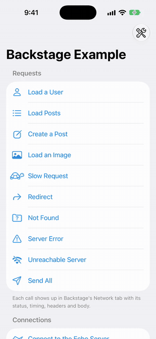
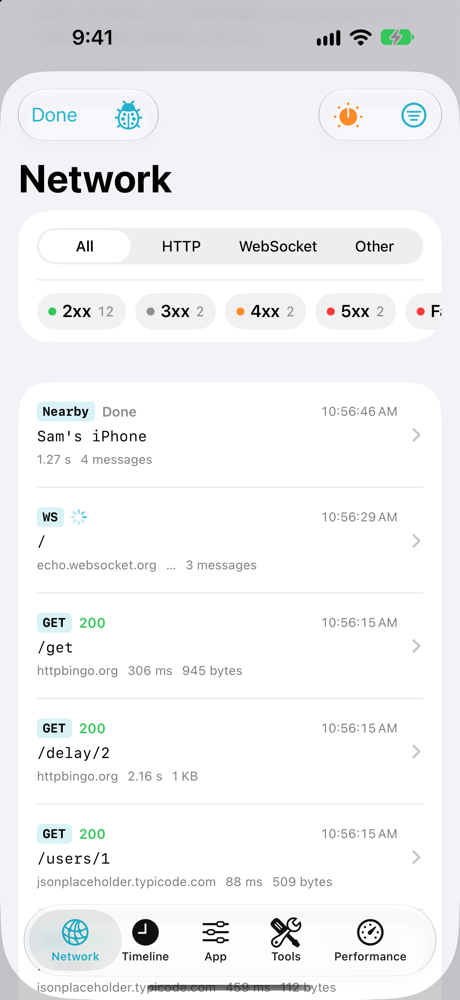
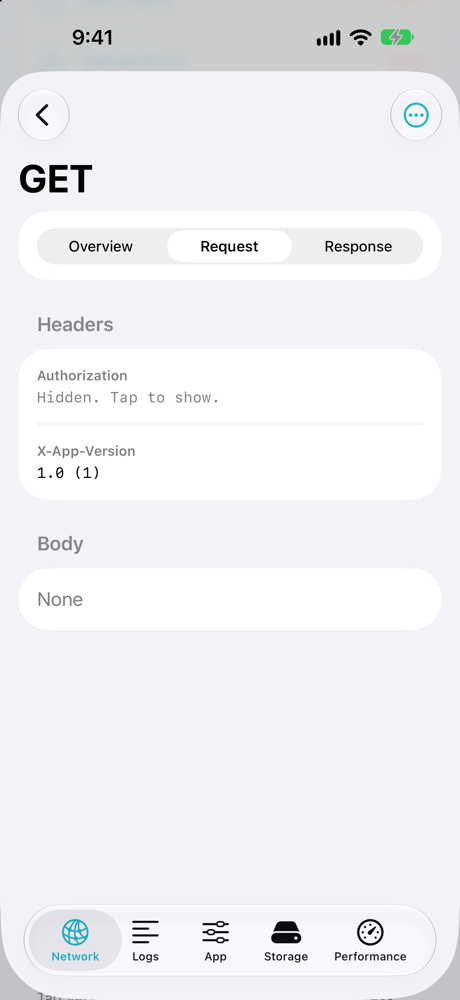
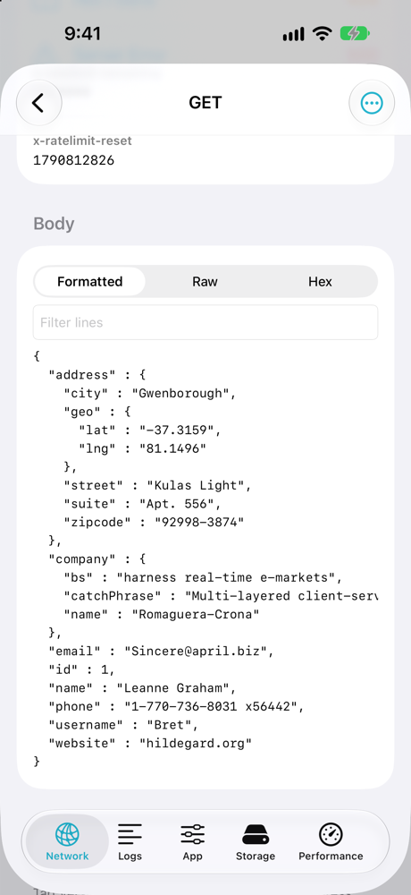
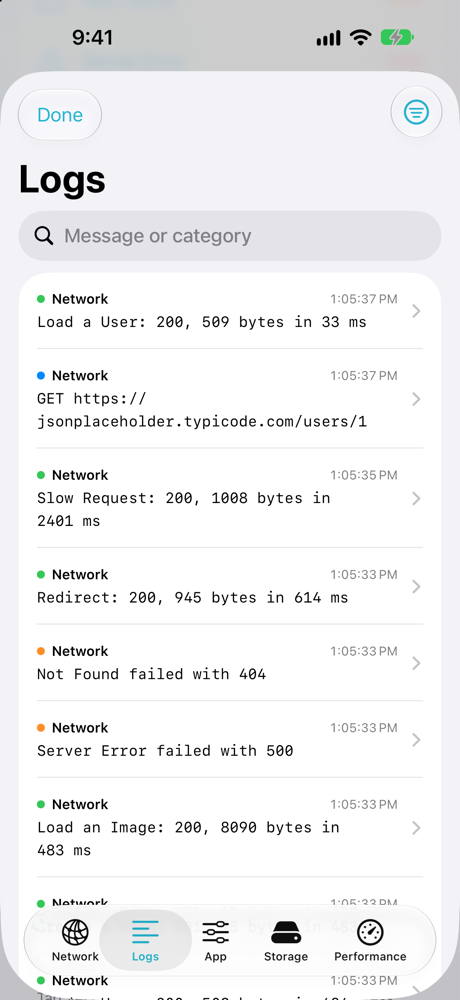
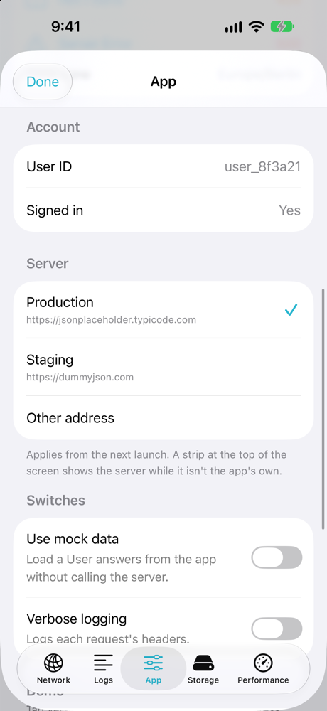
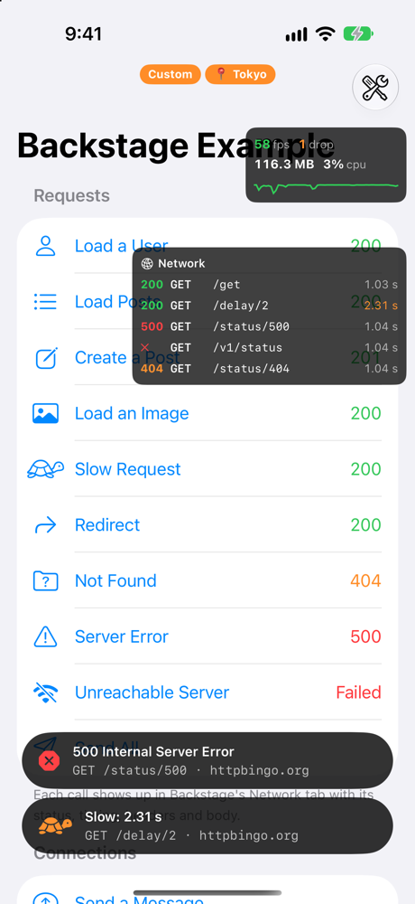

# Backstage

An in-app debug panel for the owner's apps: every network call the app makes, its logs, a server
switch, the app's own actions and switches, its storage, and a performance overlay.

<p align="center">
  
</p>

| Network | Request | Response |
|---|---|---|
|  |  |  |
| **Logs** | **App** | **Performance overlay** |
|  |  |  |

It's for the owner only:

| Where the app runs | Backstage |
|---|---|
| Xcode (a Debug build, the simulator, or any build run from Xcode) | On from launch. Shake, ⌃⌥⌘D, or the hidden trigger opens it. |
| TestFlight | Off and invisible. The hidden trigger asks for a passphrase; a device unlocked with it stays unlocked until **Lock**. Recording starts when you unlock (the Network tab says so), and from the next launch on it starts at launch. Testers' devices record nothing. |
| App Store | Off. Nothing is recorded and nothing opens it. |

TestFlight and App Store builds are the same binary, so Backstage decides when the app runs: it
asks StoreKit's `AppTransaction` (`.xcode`, `.sandbox` for TestFlight, `.production`). Anything
it can't tell counts as the App Store.

## Trying it

`Example/BackstageExample.xcodeproj` is a small app that uses everything: requests to public
test servers (JSON, an image, a redirect, a 404, a 500, a slow one, one that fails), a WebSocket
to an echo server, a made-up Nearby connection, a server switch, switches, actions, a few
UserDefaults values and a Keychain item, and a button that freezes the main thread. It uses this
checkout of the package, so changes show up at once.

Open it in Xcode and run it on a simulator or a Mac. It's a Debug build, so Backstage is on:
tap Version seven times, shake, or press ⌃⌥⌘D. Its TestFlight passphrase is `backstage-example`.

## Adding it to an app

1. Add the package by its URL (Xcode > Add Package Dependencies) and the **Backstage** product to
   the app target. For Xcode Cloud, give it access to this repository once (App Store Connect >
   Xcode Cloud > Settings > Repositories).
2. Make a passphrase hash: `swift run backstage-passphrase` in this repository. It asks for the
   passphrase (8 characters or more; mix letters, digits and symbols) without showing it and prints the salt and hash. Only
   those go in the app. The hash is PBKDF2-HMAC-SHA256 with 600,000 rounds, so someone who finds
   it in the app can only test a few guesses a second; a long passphrase keeps it out of reach.
3. Start it first thing at launch, before anything makes a network session:

   ```swift
   import Backstage

   @main
   struct MyApp: App {
       private let backstage: Void = Backstage.shared.start(
           BackstageConfiguration(passphraseSalt: "…", passphraseHash: "…")
       )

       var body: some Scene {
           WindowGroup {
               RootView()
                   .backstage()
           }
       }
   }
   ```

4. Put the hidden trigger on something unremarkable, such as the version row in Settings:

   ```swift
   LabeledContent("Version", value: version)
       .backstageTrigger()   // seven taps, each within two seconds of the last
   ```

5. Record the app's sessions: `Backstage.record(configuration)` on each `URLSessionConfiguration`
   before making the session. `URLSession.shared` is recorded without it. Set
   `recordsAllSessions` in the configuration to also record libraries' sessions (it adds the
   recording protocol to every new `.default` and `.ephemeral` configuration, only while Backstage
   is on).

6. Fill the App tab. Backstage shows the build and the device by itself; the rest comes from the
   app, through `Backstage.shared.registry`, right after `start(_:)`:

   ```swift
   let registry = Backstage.shared.registry

   // A server switch: the first server is the app's own.
   registry.addServers(key: "api", servers: [
       .init("Live", url: URL(string: "https://api.example.com")!),
       .init("Staging", url: URL(string: "https://staging.example.com")!)
   ])

   // Lines of information, read each time the tab is shown. `group` names the section.
   registry.addInfo("User ID", group: "Account") { session.userID }

   // Switches and buttons.
   registry.addSwitch("Use mock data", key: "mockData", footnote: "Answers without the server.")
   registry.addAction("Sign out", group: "Account", isDestructive: true) { await session.signOut() }
   ```

   The app reads the choices itself. Read the server once at launch, before making its client;
   the switch can be read any time:

   ```swift
   let baseURL = Backstage.server(for: "api") ?? URL(string: "https://api.example.com")!
   if Backstage.isOn("mockData") { … }
   ```

   Both answer "nothing chosen" in App Store builds and while Backstage is off, so the app falls
   back to its own server and behaviour. A server chosen in the panel is used from the next
   launch: the tab says so until the app is reopened, and a strip at the top of the screen then
   shows the server while it isn't the app's own. "Other address" takes any address, such as a
   server on the Mac (`192.168.1.10:8080`; http is assumed). See
   [the example app](Example/BackstageExample/BackstageExampleApp.swift) for each kind.

## What's in the panel

However it's opened, the panel comes back on the tab it was last on.

- **Network.** Every HTTP call: method, URL, status, timing, headers and bodies (cut at 1 MB),
  with search and filters (kind, status, method, host, this launch only), pretty JSON, copy as
  cURL, and export as HAR or JSON. `Authorization`,
  cookies and API keys stay hidden until tapped and are left out of exports. The last 1,000 calls
  are kept across launches in the app's Caches. WebSockets and other connections the app reports
  (`NetworkRecorder.shared.openConnection(kind:url:headers:note:)`) show with their messages;
  the recording protocol itself leaves WebSocket tasks alone. A redirect shows as its own call,
  followed by the one it led to.
- **Simulate** (the dial in the Network tab). For the calls Backstage records:
  - A network condition: Slow 3G (2 s, 50 KB/s), Flaky (a fifth of calls drop), Offline, or a
    custom delay, speed and failure rate, for every host or one. It lasts until the app is
    reopened.
  - Fake responses: rules that match a method and a URL (`*` stands for anything; without a `?`
    the query is ignored) and answer with a status, headers and body, or with a failure such as a
    timeout, without reaching the server. **Fake This Response** on a recorded call starts one
    from its real answer. They're kept across launches, each with its own switch.

  Simulated calls are tagged in the list, and an orange strip at the top of the screen shows
  what's on (`Offline · 2 fakes`). WebSockets and other reported connections aren't affected.
- **Logs.** This launch's `Logger` and `NSLog` messages, read with `OSLogStore`, filtered by level
  and category. Only the app's own code is shown (its executable, the packages linked into it and
  its frameworks) unless **App's Messages Only** is turned off to see the system's messages too.
- **App.** Where it runs, the build and the device, then what the app adds (step 6 above):
  - `addServers(key:servers:)`: a server switch, read with `Backstage.server(for:)`.
  - `addInfo(_:group:value:)`: lines of information, such as IDs.
  - `addSwitch(_:key:group:footnote:)`: switches, read with `Backstage.isOn(_:)`.
  - `addAction(_:group:isDestructive:perform:)`: buttons.
  - **Lock Backstage**, in TestFlight builds.
- **Storage.** The app's UserDefaults (edit, delete), Keychain items (show a value after
  confirming, delete) and files (browse, share, delete).
- **Overlays** (at the top of the Performance tab), small windows above every screen. Each can be
  dragged anywhere and stays where it's left; tapping one opens Backstage, and a long press
  hides it. They stay on across launches.
  - **Performance:** frame rate, dropped frames, memory and CPU, and a one-minute graph. A
    flash marks a main-thread hang (over 250 ms).
  - **Network:** this launch's calls. **Compact** shows the calls running and failed in the last
    minute, the last call, and a bar per call coloured by result, taller the slower. **Ticker**
    lists the last five calls. **In Performance Overlay** adds two lines to it instead of a
    window of its own.
  - **Alerts on failed or slow calls:** a short alert at the bottom of the screen for a call
    that fails or takes 2 s or more, gone after a few seconds. On with any of the above, or alone.
- **Performance.** The tab adds charts, the
  last hangs and the screen's top rate. On a 120 Hz iPhone, iOS holds an app to 60 fps unless
  its Info.plist sets `CADisableMinimumFrameDurationOnPhone` to YES; the tab says so when it's
  missing (the example app sets it).
- **Reports from iOS** (in the Performance tab). What iOS collects about the app through
  MetricKit: crashes, hangs, CPU and disk-write overuse and slow launches with their call stacks,
  which arrive on the next launch, and a daily summary (typical launch and hang, peak memory,
  CPU, disk writes, time on screen and in the background). Each can be copied or shared as iOS
  wrote it. Call stacks are addresses; Xcode or `atos` turns them into names with the build's
  dSYM. Reports delivered while Backstage was off are picked up when it turns on, and kept for
  30 days in the app's Caches. A crash reporter the app already uses keeps getting its own.
  Nothing arrives in the simulator: on a device connected to Xcode, Debug > Simulate MetricKit
  Payloads sends samples, and the example app has **Add sample iOS reports**.

## How it's built

- `BackstageCore`: when it's on, the passphrase, the recorder (`NetworkRecorder`,
  `RecordingURLProtocol`), the simulator (`NetworkSimulator`), logs, Keychain, performance
  sampling and iOS's reports (`IOSReportStore`). No UI.
- `Backstage`: the SwiftUI panel. On iPhone and iPad it lives in its own window above the app's,
  so it opens over sheets and the overlay stays on top; touches pass through everywhere else. On
  the Mac the panel and the overlay are their own windows.
- iOS 18 and macOS 15, Swift 6, no dependencies. Nothing leaves the device unless the owner
  exports it.

`swift test` runs the core's tests: when it's on, the passphrase, recording limits, files across
launches, export, requests recorded through the protocol (redirects included, WebSockets left
alone), the simulator's rules, fakes and conditions, and reading iOS's reports.

## License

MIT. See [LICENSE](LICENSE).
